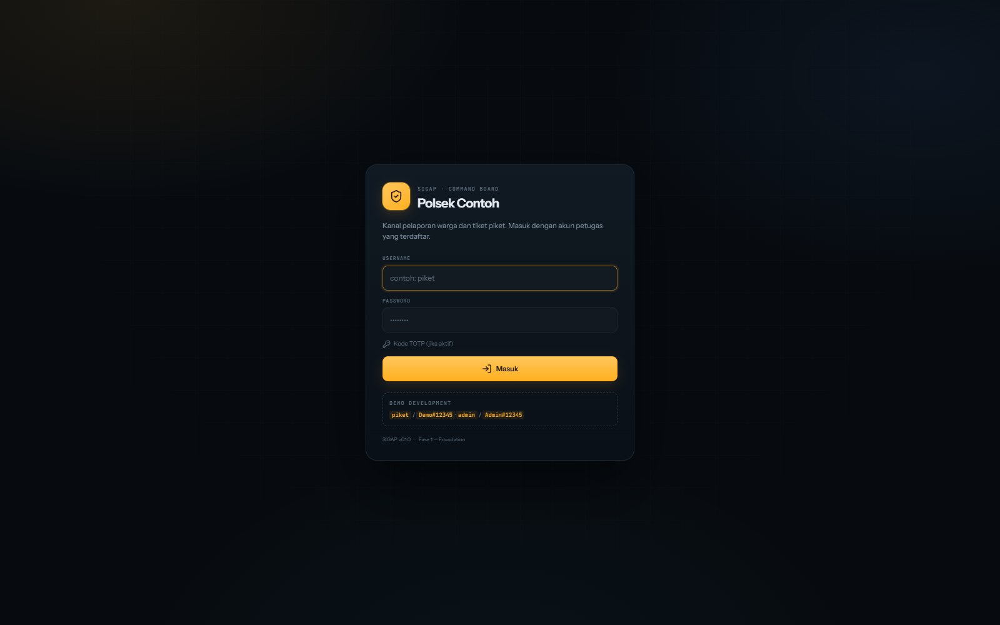
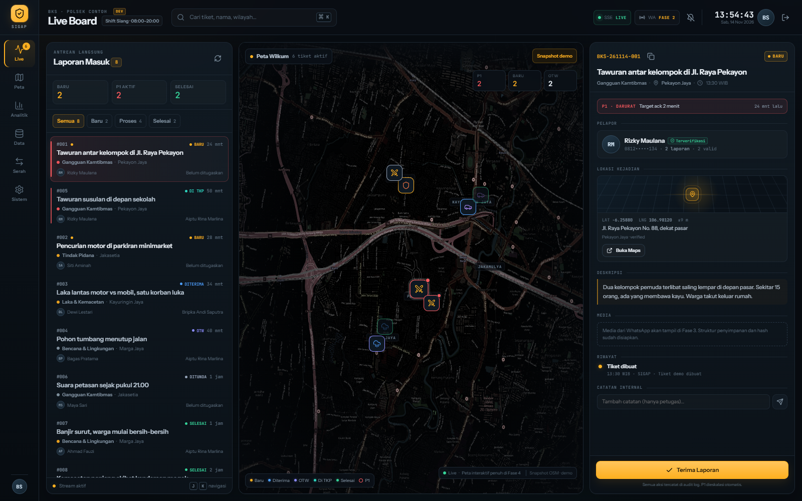
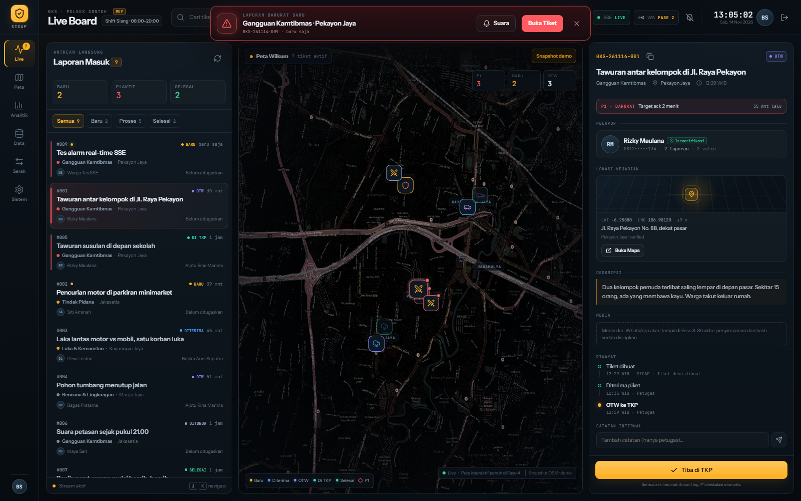
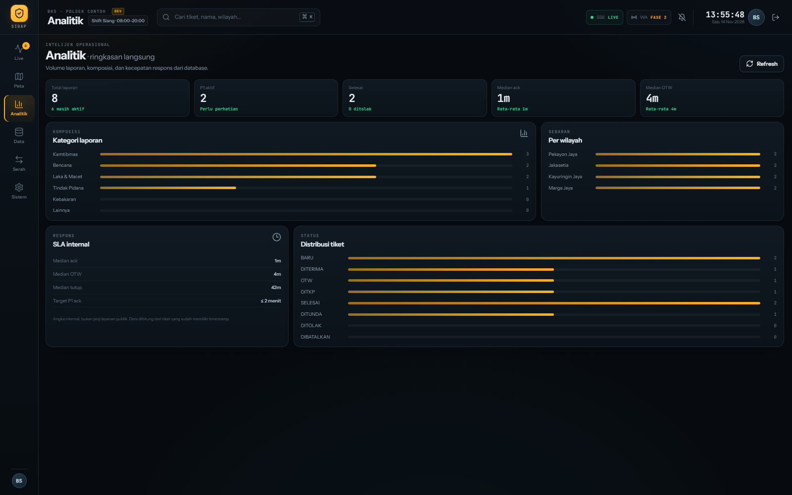
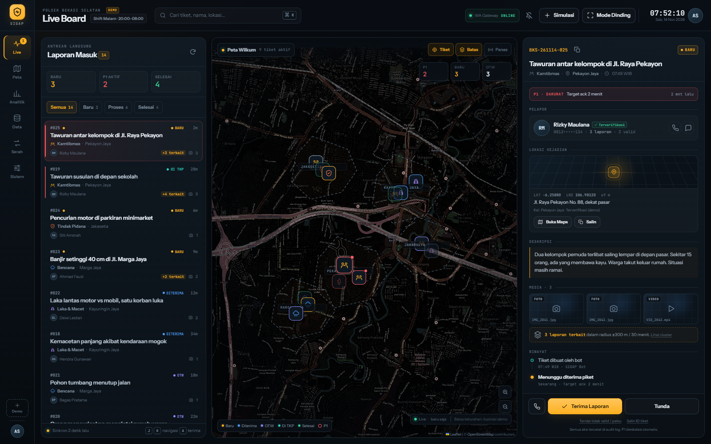
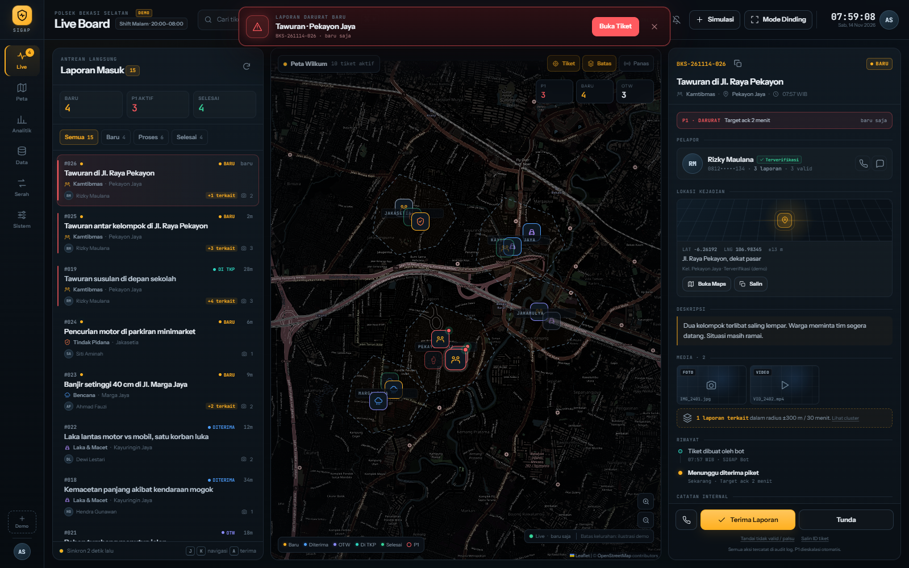
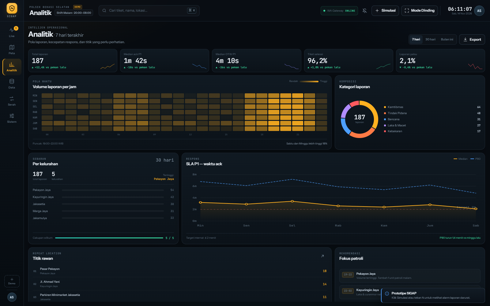
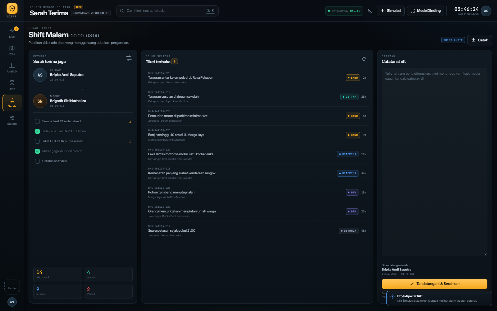
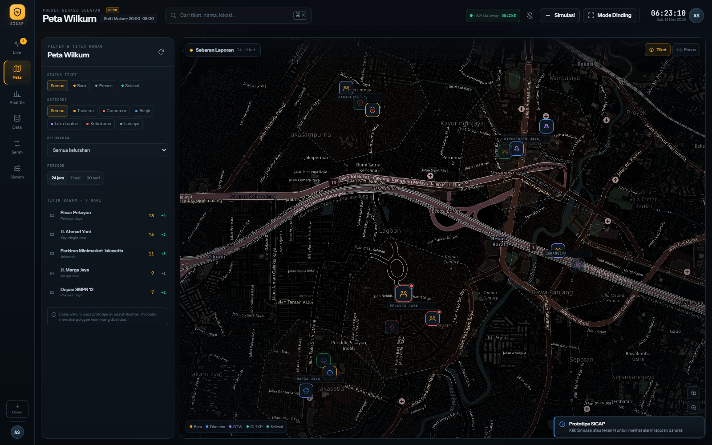

# SIGAP — Sistem Informasi Gangguan & Aduan Publik

> **Working title.** Prototipe dashboard + WhatsApp bot untuk kanal pelaporan warga di wilayah hukum Polsek.
> Satu pesan → satu tiket → satu respons yang tercatat.

Status: **v1.2 — Fase 1–9 selesai + audit lanjutan diperbaiki; pilot lapangan blocked** (23 Nov 2026)
Pemilik produk: Kapolsek / Pawas
Pengembang: _diisi_
Fase selesai: Discovery + prototipe UI, API + web shell, bot Baileys, pipeline media, dashboard (peta/eskalasi/handover), analitik + export + digest + admin/PWA, hardening, UAT + dokumen operasional, pairing WhatsApp dari dashboard + audit kode.
Panduan lengkap: [`docs/24-PANDUAN-PENGGUNAAN.md`](docs/24-PANDUAN-PENGGUNAAN.md). **Deploy produksi: [`docs/26-DEPLOY.md`](docs/26-DEPLOY.md).** Audit: [`docs/25-AUDIT-KODE.md`](docs/25-AUDIT-KODE.md) + [`docs/27-AUDIT-LANJUTAN.md`](docs/27-AUDIT-LANJUTAN.md).

## Mulai cepat

| Saya ingin… | Baca / jalankan |
|---|---|
| Menjalankan di laptop | [Menjalankan aplikasi](#menjalankan-aplikasi-fase-19) di bawah |
| Coba di server demo (1 perintah) | [`deploy/README.md`](deploy/README.md) — `pnpm release` → upload `.tar.gz` → `sudo bash deploy/install.sh <domain>` |
| Deploy ke server produksi | [`docs/26-DEPLOY.md`](docs/26-DEPLOY.md) (server kosong → go-live, update, rollback, rotasi secret) |
| Paham alur laporan WhatsApp | [Alur laporan WhatsApp](#alur-laporan-whatsapp) |
| Tahu apa yang berubah setelah audit | [`docs/27-AUDIT-LANJUTAN.md`](docs/27-AUDIT-LANJUTAN.md) |
| Operasional harian / insiden | [`docs/17-RUNBOOK.md`](docs/17-RUNBOOK.md) |

---

## Kenapa proyek ini ada

Warga butuh kanal lapor yang **tanpa instal aplikasi**, cepat, dan tidak ribet. Polsek butuh laporan yang **langsung menjadi tiket**, terlihat di dashboard piket, terdisposisi ke URC/Bhabinkamtibmas, dan bisa dipertanggungjawabkan secara operasional maupun hukum.

WhatsApp dipilih karena sudah ada di tangan warga. Dashboard dipilih karena piket butuh satu layar kerja, bukan tumpukan chat.

## Isi repo

| Path | Isi |
|---|---|
| `docs/00-RINGKASAN-EKSEKUTIF.md` | 1 halaman untuk pimpinan: masalah, usulan, biaya, keputusan |
| `docs/01-KRITIK-GEMINI.md` | Review kritis rencana awal + daftar lubang dan solusinya |
| `docs/02-PRD.md` | Product Requirements Document lengkap |
| `docs/03-ARSITEKTUR.md` | Arsitektur, stack, skema data, deployment tanpa Docker |
| `docs/04-RENCANA.md` | Rencana fase, timeline, gate, dan anggaran |
| `docs/05-TASKS.md` | Backlog task per epic, siap dieksekusi |
| `docs/06-PROGRESS.md` | Log progres, keputusan, blocker |
| `docs/07-RISIKO.md` | Register risiko + mitigasi + contingency |
| `docs/08-SOP.md` | SOP final piket, URC, Bhabin, serah terima, downtime |
| `docs/09-KEPUTUSAN.md` | ADR (Architecture Decision Records) |
| `docs/10-PERTANYAAN-TERBUKA.md` | Hal yang masih harus diputuskan pimpinan |
| `docs/11-UI-KIT.md` | Token desain, komponen, aksesibilitas, performa |
| `docs/12-API.md` | Referensi API: auth, tiket, media, analitik, export, push |
| `docs/13-SECURITY-REVIEW.md` | Security review + bukti uji |
| `docs/14-UAT-HASIL.md` | Hasil UAT-01..20 |
| `docs/15-PELATIHAN.md` | Materi pelatihan piket/URC/Bhabin/admin |
| `docs/16-LAUNCH-PLAN.md` | Pilot, soft launch, full launch, rollback |
| `docs/17-RUNBOOK.md` | Deploy, backup, restore, failure drill, insiden |
| `docs/18-PANDUAN-ADMIN.md` | Panduan admin unit |
| `docs/19-PANDUAN-PIKET.md` | Panduan piket 1 halaman |
| `docs/20-PANDUAN-WARGA.md` | Panduan/poster warga |
| `docs/21-SERAH-TERIMA-KREDENSIAL.md` | Checklist serah terima kredensial |
| `docs/22-REVIEW-BULANAN.md` | Agenda review bulanan |
| `docs/23-VIDEO-WARGA.md` | Storyboard video 90 detik |
| `docs/24-PANDUAN-PENGGUNAAN.md` | Panduan lengkap: alur, role, grup, JID, pairing WA, tema, troubleshooting |
| `docs/25-AUDIT-KODE.md` | Audit kode/script, temuan, alasan, rekomendasi |
| `docs/26-DEPLOY.md` | **Panduan deploy produksi**: server, user, env, systemd, Caddy/CSP, pairing, backup, smoke test, update, rollback, rotasi secret |
| `docs/27-AUDIT-LANJUTAN.md` | Audit lanjutan Nov 2026: 25 temuan, perbaikan, test regresi, perubahan perilaku |
| `docs/assets/` | Poster warga PNG/SVG |
| `apps/api/` | API Fastify + SQLite/Drizzle + auth + SSE + audit + internal bot API |
| `apps/bot/` | Bot WhatsApp Baileys (QR pairing, inbound, outbox, group command) |
| `apps/web/` | Dashboard React/Vite (login, live board, analitik, settings) |
| `packages/core/` | Domain: state machine, geofence, nomor tiket, schema |
| `packages/config/` | Validasi environment |
| `infra/` | systemd, Caddy, backup, healthcheck |
| `prototype/` | Prototipe UI/UX yang bisa diklik (mock data, tanpa build) |
| `prototype/screenshots/` | Tangkapan layar prototipe desain |
| `screenshots/phase1/` | Tangkapan layar aplikasi nyata Fase 1 |

## Keputusan kunci (ringkas)

1. **Semua warga boleh lapor**, bukan hanya RT/RW/Camat. Yang dibatasi adalah **lokasi kejadian (TKP)**, bukan domisili pelapor.
2. **Wilkum divalidasi dengan polygon kelurahan** (point-in-polygon), bukan radius kasar. Di luar wilkum → diarahkan ke hotline 110 + Polsek terdekat.
3. **Nama pelapor wajib.** Untuk laporan darurat, tiket dibuat lebih dulu agar respons tidak tertunda, lalu nama dilengkapi menyusul.
4. **Full Baileys** untuk WhatsApp (termasuk forward ke grup URC), dengan asumsi risiko banned dan rencana cadangan.
5. **Tanpa Docker.** Node.js + systemd + Caddy di VPS Linux. API dan bot berjalan sebagai user Unix terpisah.
6. **SQLite + Drizzle** untuk v1 (volume Polsek), bukan Postgres/PostGIS. Polygon dihitung di aplikasi dengan Turf.
7. **Prototype dulu**, baru backend. Prototipe ada di `prototype/index.html`.

## Menjalankan aplikasi (Fase 1–9)

Butuh Node.js 24 + pnpm.

```powershell
cp .env.example .env
pnpm install
pnpm db:migrate
pnpm db:seed
pnpm dev
```

> **Jangan pakai secret default `.env.example` dengan nomor WhatsApp atau data warga asli**, termasuk di laptop. Kuncinya publik di repo, jadi enkripsi nomor pelapor menjadi tidak berarti. API mencetak peringatan saat start bila secret masih default. Untuk mengganti tanpa kehilangan data (matikan API & bot dulu):
>
> ```powershell
> pnpm --filter @sigap/api secrets:rotate -- --write-env ../../.env
> ```

Perintah lain:

```powershell
pnpm -r typecheck   # TypeScript seluruh workspace
pnpm -r test        # 120 test (core, bot, API)
pnpm -r build       # build produksi API, bot, web
pnpm release        # test + build + paket release/sigap-v<versi>.tar.gz untuk server
```

### Upload ke GitHub

`.gitignore` sudah mengecualikan `.env`, `data/` (database, media bukti, sesi WhatsApp), `release/`, `node_modules/`, `dist/`, dan file backup. Sebelum push pertama, cek ulang:

```powershell
git status --short
git check-ignore -v .env data/sigap.db data/baileys
```

`pnpm dev` menjalankan API + web + bot. Jika hanya ingin API/web: `pnpm dev:api` dan `pnpm dev:web` di terminal terpisah.

Media WhatsApp disimpan di `SIGAP_MEDIA_DIR` (default `data/media`), **di luar webroot**. Backup folder ini bersama `data/sigap.db`; tanpa folder media, bukti foto/video/voice note hilang meskipun database masih ada.

- Web: `http://localhost:5173`
- API: `http://localhost:4000`
- Health: `http://localhost:4000/health`
- Bot: otomatis jalan; pairing dilakukan dari **Sistem → WhatsApp Gateway**, bukan file QR.

### Pairing WhatsApp (Fase 9)

1. Jalankan `pnpm dev` (atau `pnpm dev:bot`).
2. Login admin → **Sistem → WhatsApp Gateway**.
3. Klik **Hubungkan WhatsApp**; QR muncul di kartu.
4. Scan lewat **WhatsApp > Perangkat tertaut > Tautkan perangkat**.
5. Setelah **TERHUBUNG**, sesi tersimpan di `data/baileys/`.
6. **Logout / ganti nomor** menghapus sesi dan memungkinkan pairing ulang.

> Jangan scan QR dari sumber yang tidak dikenal. Sesi WhatsApp setara dengan akses akun. QR hanya terlihat oleh admin dan berlaku ±90 detik.

Agar forward tiket dan command grup URC aktif:

1. Isi **Sistem → ID grup URC** dengan angka ID grup. Kirim `/id` di grup untuk melihat ID-nya.
2. Simpan; API otomatis mendaftarkan grup sebagai grup aktif.
3. Isi nomor WA petugas di **Sistem → Petugas** (otomatis menjadi JID).
4. Seed demo memakai `628000000001` dan seterusnya; ganti lewat Pengaturan untuk nomor nyata.

Seed development membuat akun demo:

| Akun | Password | Role |
|---|---|---|
| `piket` | `Demo#12345` | Piket SPKT |
| `urc` | `Demo#12345` | URC |
| `kapolsek` | `Demo#12345` | Kapolsek |
| `admin` | `Admin#12345` | Admin |

> Akun demo hanya dibuat jika `SIGAP_SEED_DEMO=true` dan bukan produksi. `SIGAP_ENV=production` akan menolak start jika secret masih default, token internal < 32 karakter, cookie tidak secure, atau seed demo aktif.
>
> Akun yang dibuat admin (dan password hasil reset admin) **wajib diganti saat login pertama**: min. 10 karakter, huruf + angka. Akun terkunci 15 menit setelah 10 kali gagal login.

## Alur laporan WhatsApp

```text
Warga kirim pesan
 ├─ "LAPOR"                → nama (sekali) → kategori → cerita → lokasi → media → SELESAI → ringkasan → 1 = Kirim
 │                            → tiket P2/P3 + forward grup URC
 ├─ ada kata "DARURAT"     → tiket P1 LANGSUNG + alarm dashboard + grup URC + push
 │                            → (nama) → minta lokasi → foto/detail → SELESAI
 ├─ kata kunci lain         → bot bertanya "Apakah ini DARURAT?"
 │  (banjir, laka, begal…)    1 = YA → P1   ·   2 = TIDAK → laporan biasa (teks awal jadi deskripsi)
 ├─ share location saja     → mulai laporan biasa dengan lokasi terisi (ketik DARURAT untuk P1)
 ├─ "STATUS" / "STATUS BKS-…" → status tiket milik pelapor
 └─ "NAMA …", "BATAL", "BANTU"
```

- **Lokasi di luar wilkum:** laporan biasa diarahkan ke 110/Polsek terdekat. Laporan **darurat tidak pernah ditolak otomatis**; tiket tetap aktif dengan tanda "di luar wilkum" dan piket yang memutuskan.
- **Grup URC:** `/otw`, `/tiba`, `/selesai`, `/tunda <alasan>`, `/status`, `/id`. Nomor pendek (`/otw 3`) berarti tiket **hari ini**; bila tidak ada, satu-satunya tiket aktif bernomor itu; bila ambigu, bot meminta nomor lengkap.
- **Keandalan:** bot menyimpan setiap pesan ke antrean di disk dan mengirim ulang sampai API menerima, sehingga laporan tidak hilang saat API restart. Urutan pesan per chat dijaga.
- **Anti-spam:** lebih dari 12 pesan/menit dari satu chat tetap diproses, tetapi balasan bot dijeda; nomor yang diblokir hanya dibalas sekali per 6 jam.

### Yang sudah jalan di Fase 1

- Login sesi + cookie HttpOnly, Argon2id, TOTP setup/enable.
- RBAC: admin, kapolsek, pawas, piket, urc, bhabin.
- Tiket: list, detail, transisi state machine, catatan, tiket manual.
- Geofence point-in-polygon + buffer 250 m + klasifikasi lokasi.
- SSE real-time + alarm P1 di dashboard.
- Pengaturan unit/SLA/WA/DPO/retensi.
- Registry wilayah (GeoJSON) + petugas.
- Audit log append-only.
- Analitik ringkas dari database.
- Web: login, live board, detail, aksi status, pencarian, alarm, analitik.
- Web **Pengaturan admin**: identitas unit, WA, DPO, retensi, SLA, upload polygon wilayah.
- **Bot Baileys**: QR pairing, auto-reconnect, inbound teks/lokasi/media, state machine percakapan, emergency P1, outbox worker, forward grup teks + media, command `/otw`, `/tiba`, `/selesai`, `/tunda`, `/status`, `/id`.
- **Media WhatsApp**: foto, video, dan voice note; SHA-256, thumbnail, EXIF GPS, disimpan di luar webroot dan disajikan lewat `/api/media/:id` dengan sesi petugas. Media asli ikut diteruskan ke grup URC.
- **Bukti grup**: foto dengan caption `/selesai <tiket>` otomatis terlampir ke tiket.
- **Peta Leaflet**: basemap terang OpenStreetMap (fallback Esri), polygon wilayah dari database, label batas wilkum, pin status/kategori, filter, mini-map Live Board.
- **Eskalasi P1**: worker 60 detik, notifikasi Pawas (3 menit) dan Kapolsek (10 menit) via WA + SSE + Web Push.
- **Serah terima**: checklist shift, tiket terbuka, catatan, nama petugas masuk, tanda tangan nama + audit.
- **Duplikat & merge**: deteksi radius 500 m / 60 menit, gabungkan tiket, media ikut pindah.
- **PII reveal**: dashboard selalu masked; nomor bisa ditampilkan 30 detik dengan audit. Notifikasi WhatsApp (grup/eskalasi) bisa menampilkan nomor penuh lewat setting **Masking PII**.
- **Command grup**: `/otw`, `/tiba`, `/selesai`, `/tunda` hanya untuk piket/urc/pawas/admin; pesan penolakan menyebut role pengirim dan role yang diizinkan. Update ke pelapor memakai bahasa operasional (“sedang jalan ke TKP”, “sudah tiba di TKP”, “sudah selesai ditangani”).
- **Audit viewer** dan **TOTP setup** di dashboard.
- **Mode dinding** + keyboard `J/K`, `/`, `W`, `Esc`.
- **Analitik lanjutan**: volume 14 hari, heatmap jam, titik rawan, p90, kepatuhan SLA P1.
- **Export**: CSV, Excel, PDF bulanan (dibuat di API + audit).
- **Digest harian**: otomatis setelah 07:00 WIB + trigger manual, ke Kapolsek/grup URC.
- **Admin**: tambah/edit/hapus petugas (hapus = nonaktif jika ada riwayat), tambah/hapus wilayah (nonaktif jika masih dipakai), kelola grup WA, blokir/buka blokir pelapor.
- **PWA**: manifest + service worker; API tidak pernah dicache; Web Push VAPID untuk P1/eskalasi.
- **Pairing WhatsApp dari dashboard**: QR di Settings, connect/disconnect/logout/restart, heartbeat bot, tanpa terminal.
- **Tema**: default terang, toggle gelap, peta selalu terang.
- **Hardening**: CSRF, rate limit, IDOR, enkripsi phone + TOTP, backup + restore drill, healthcheck, security review, audit kode.
- **Audit lanjutan (v1.2)**: antrean pesan masuk persisten, konfirmasi darurat, tanpa auto-tolak P1, rate limit login per username + lockout akun, anti-replay TOTP, ganti/reset password + wajib ganti password awal, referensi tiket grup aman, buka-ulang tanpa eskalasi/statistik ganda, pelapor LID, soft delete petugas, bot dengan user & env terpisah, CSP hash benar, skrip rotasi secret.
- Test: 28 unit test domain + 77 test API (termasuk 15 regresi audit) + 15 test bot (normalisasi + antrean) = **120 test**.

### Tampilan aplikasi Fase 1

| | |
|---|---|
|  |  |
| **Login** — sesi + unit config | **Live board** — data dari API, SSE, detail |
|  |  |
| **Alarm SSE** — P1 baru masuk | **Analitik** — data langsung dari database |

### Belum / lanjut

- Kategori & template pesan yang bisa diedit admin.
- E2E Playwright otomatis (saat ini E2E manual via browser).
- Recovery codes TOTP (sementara: admin bisa **Reset TOTP**).
- Keputusan dasar hukum consent PDP bersama DPO (lihat `docs/27-AUDIT-LANJUTAN.md`).
- Pairing nomor WA aktual (butuh nomor + 2FA dari pimpinan).
- Deployment produksi aktual (domain/hosting menyusul).
- Pilot 1 kelurahan, soft launch, full launch, hypercare (butuh lapangan + waktu).

### Endpoint API utama

| Method | Path | Akses |
|---|---|---|
| `GET` | `/health` | publik |
| `GET` | `/api/public/config` | publik |
| `POST` | `/api/auth/login` | publik |
| `POST` | `/api/auth/logout` | sesi |
| `GET` | `/api/me` | sesi |
| `POST` | `/api/auth/password` | sesi (ganti password sendiri) |
| `POST` | `/api/auth/totp/setup` | sesi |
| `POST` | `/api/auth/totp/enable` | sesi |
| `GET` | `/api/tickets` | sesi |
| `GET` | `/api/tickets/:id` | sesi (termasuk `media[]`) |
| `GET` | `/api/media/:id` | sesi |
| `GET` | `/api/media/:id/thumb` | sesi |
| `POST` | `/api/tickets/:id/transition` | sesi + RBAC |
| `POST` | `/api/tickets/:id/notes` | sesi |
| `POST` | `/api/tickets/:id/reveal-phone` | piket/pawas/kapolsek/admin/urc |
| `GET` | `/api/tickets/:id/duplicates` | sesi |
| `POST` | `/api/tickets/:id/merge` | piket/pawas/kapolsek/admin |
| `POST` | `/api/tickets/manual` | piket/pawas/admin |
| `GET/POST` | `/api/handover` | piket/pawas/kapolsek/admin/urc (POST: tanpa urc) |
| `GET` | `/api/regions` | sesi |
| `POST/PATCH` | `/api/regions` | admin |
| `GET/PATCH` | `/api/settings` | admin |
| `GET` | `/api/analytics/summary` | sesi |
| `GET` | `/api/export/tickets.csv` | piket/pawas/kapolsek/admin |
| `GET` | `/api/export/tickets.xlsx` | piket/pawas/kapolsek/admin |
| `GET` | `/api/export/monthly.pdf` | piket/pawas/kapolsek/admin |
| `POST` | `/api/system/digest` | admin/pawas/kapolsek |
| `GET/POST/PATCH` | `/api/wa-groups` | admin |
| `GET` | `/api/reporters` | admin/pawas |
| `POST` | `/api/reporters/:id/block` / `unblock` | admin/pawas |
| `GET` | `/api/stream` | sesi (SSE) |
| `GET` | `/api/system/status` | admin/pawas/kapolsek |
| `GET` | `/api/system/gateway` | admin/pawas/kapolsek |
| `GET` | `/api/officers` | admin/pawas/piket |
| `POST` | `/api/officers` | admin |
| `PATCH` | `/api/officers/:id` | admin |
| `DELETE` | `/api/officers/:id` | admin (selalu menonaktifkan) |
| `POST` | `/api/officers/:id/reset-password` | admin |
| `POST` | `/api/officers/:id/reset-totp` | admin |
| `GET` | `/api/audit` | admin/pawas |

## Menjalankan prototipe

Paling mudah:

```powershell
# dari root repo
npx --yes serve prototype -l 4173
# buka http://localhost:4173
```

Atau buka `prototype/index.html` langsung di browser. Leaflet, peta, dan data sudah dibundel lokal; hanya font yang memakai CDN dengan fallback sistem.

> Prototipe memakai **data fiktif**. Nama orang, nomor telepon, dan kejadian adalah simulasi. Tidak ada koneksi ke WhatsApp atau data kepolisian sungguhan.

## Preview



| | |
|---|---|
|  |  |
| **Alarm darurat** — banner, pin, suara | **Analitik** — heatmap, SLA, titik rawan |
|  |  |
| **Serah terima** — checklist shift | **Peta wilkum** — filter & titik rawan |

Semua tangkapan layar ada di `prototype/screenshots/`.

## Cara membaca dokumen

- Mau paham **kenapa** desainnya begini → baca `01-KRITIK-GEMINI.md`.
- Mau tahu **apa** yang dibangun → `02-PRD.md`.
- Mau tahu **bagaimana** membangunnya → `03-ARSITEKTUR.md`.
- Mau tahu **kapan** dan **siapa** → `04-RENCANA.md` + `05-TASKS.md`.
- Mau tahu **apa yang sudah jalan** → `06-PROGRESS.md`.

## Disclaimer

Ini dokumen perencanaan dan prototipe desain, bukan sistem resmi Polri. Sebelum dipakai operasional, perlu persetujuan pimpinan, kajian hukum/data protection, UAT bersama piket dan URC, serta SOP yang ditandatangani.


