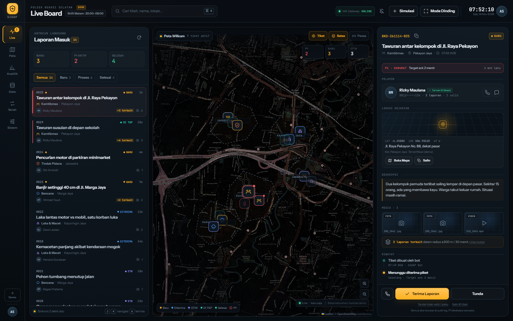
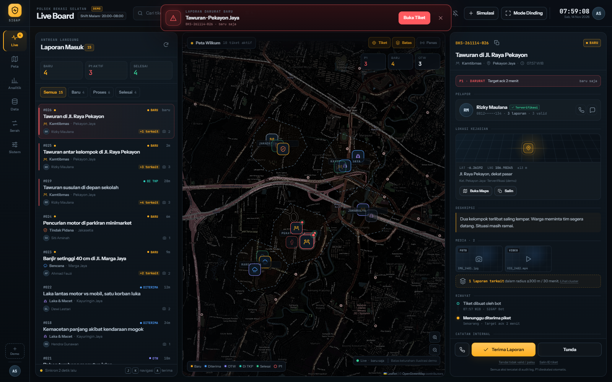
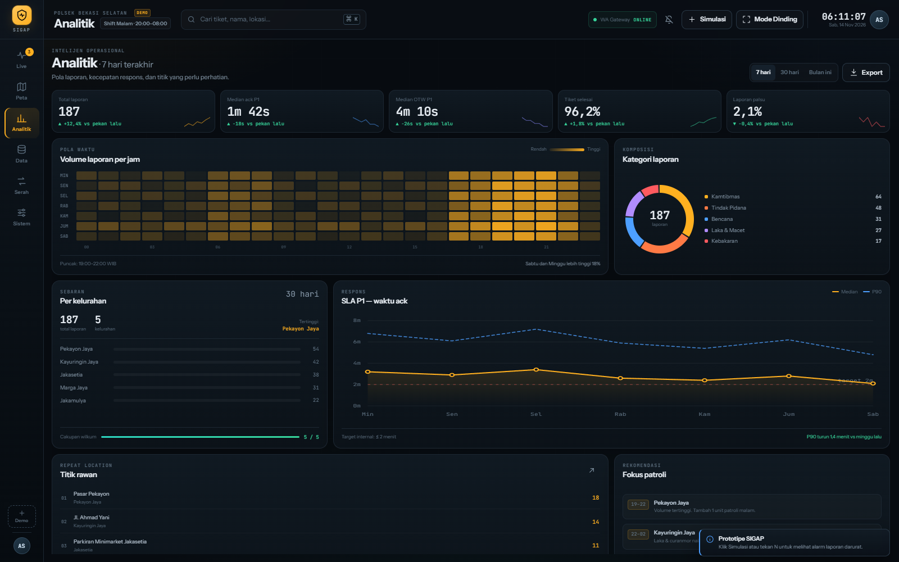
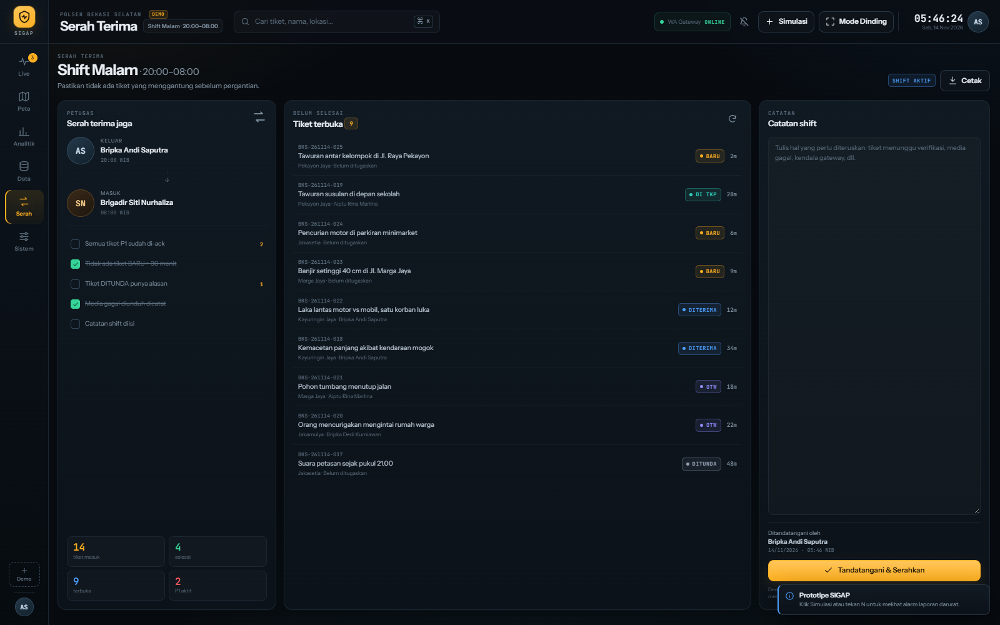
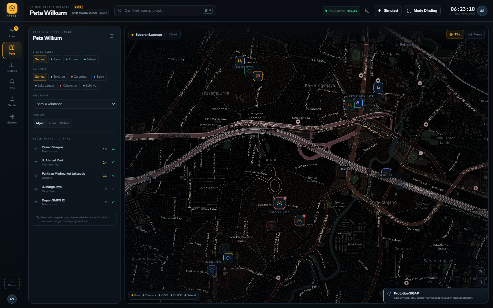
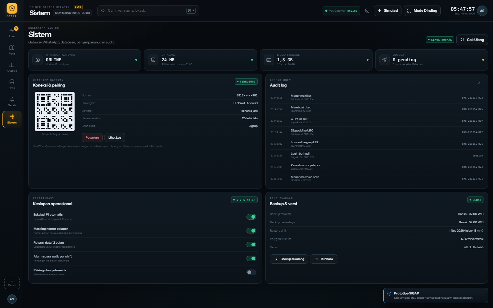

# Prototipe UI/UX — SIGAP

Prototipe ini menunjukkan **bentuk, alur, dan kepadatan informasi** dashboard piket. Semua data fiktif. Tidak ada koneksi WhatsApp, database, atau data kepolisian sungguhan.

## Menjalankan

```powershell
# dari root repo
python -m http.server 4181 --directory prototype
# buka http://localhost:4181
```

Atau buka `prototype/index.html` langsung. Peta, Leaflet, dan seluruh data sudah dibundel lokal; hanya font yang memakai CDN (dengan fallback sistem).

## Layar

| Layar | Isi |
|---|---|
| **Live Board** | Antrean tiket, peta wilkum, detail tiket, aksi status, alarm |
| **Peta** | Peta besar, filter status/kategori/kelurahan, titik rawan |
| **Analitik** | KPI, heatmap jam, kategori, SLA, titik rawan, rekomendasi patroli |
| **Data** | Registry pelapor, petugas, wilkum, grup & nomor |
| **Serah Terima** | Checklist shift, tiket terbuka, catatan, tanda tangan |
| **Sistem** | Status gateway, database, media, outbox, audit log, QR pairing |

## Coba alur ini

1. Klik **Simulasi** (atau tekan `N`) → tiket darurat baru + alarm.
2. Klik tiket di antrean → detail terbuka.
3. Klik **Terima Laporan** → status `DITERIMA`.
4. Klik **OTW ke TKP** → status `OTW`.
5. Klik **Tiba di TKP** → status `DI TKP`.
6. Klik **Selesaikan** → status `SELESAI`.
7. Buka **Serah Terima** → lihat tiket terbuka dan checklist.
8. Buka **Analitik** → lihat heatmap dan SLA.

## Keyboard

| Tombol | Aksi |
|---|---|
| `J` / `K` | Pindah tiket |
| `A` | Aksi utama (terima/OTW/tiba/selesai) |
| `N` | Simulasi laporan baru |
| `W` | Mode dinding |
| `1`–`6` | Pindah layar |
| `/` atau `Ctrl/Cmd + K` | Pencarian |
| `Esc` | Tutup panel/palette/alarm |

## Yang dimock

- Tiket, pelapor, petugas, grup, audit, dan grafik.
- Peta memakai **snapshot lokal OSM** area Bekasi dengan filter gelap, dibundel di `assets/map-bekasi.jpg`. Ini hanya untuk prototipe; produksi harus memakai tile berlisensi/self-hosted dengan atribusi yang sesuai.
- Tombol telepon/chat/export hanya menampilkan toast.
- QR pairing adalah placeholder, bukan QR asli.
- Media tile adalah placeholder grafis, bukan foto kejadian.

## Tangkapan layar

| | |
|---|---|
|  |  |
| **Live Board** — antrean, peta, detail | **Alarm darurat** — banner, pin, suara |
|  |  |
| **Analitik** — heatmap, SLA, titik rawan | **Serah Terima** — checklist dan tiket terbuka |
|  |  |
| **Peta wilkum** — filter dan titik rawan | **Sistem** — gateway, backup, audit |

Layar lain: [`data.png`](screenshots/data.png), [`palette.png`](screenshots/palette.png), [`wall.png`](screenshots/wall.png), [`mobile.png`](screenshots/mobile.png).

## Arah desain

**"Quiet command center"** — dark, padat, tenang, cepat. Referensi rasa: Anduril Industries (disiplin data), Linear (kecepatan & keyboard), Flightradar24 (live map). Bukan website marketing; tidak ada animasi berat.

Prinsip:
- Kontras tinggi untuk monitor piket, tetapi tidak menyilaukan.
- Aksen amber untuk perhatian, merah hanya untuk P1/darurat.
- Status selalu punya label + warna, bukan warna saja.
- Tipografi: Instrument Sans untuk UI, JetBrains Mono untuk ID/waktu.
- Data padat, tetapi jarak antar-blok cukup untuk dibaca dari jarak 2 meter.
- Mode dinding memperbesar tipografi dan menyembunyikan rail.

## Catatan produksi

Prototipe ini **bukan** kode produksi. Untuk implementasi:
- Ganti tile peta dengan provider berlisensi.
- Ganti semua handler mock dengan API Fastify + SSE.
- Tambahkan autentikasi, RBAC, audit, dan enkripsi.
- Gunakan data asli yang sudah divalidasi.
- Uji aksesibilitas dan performa di perangkat piket.
